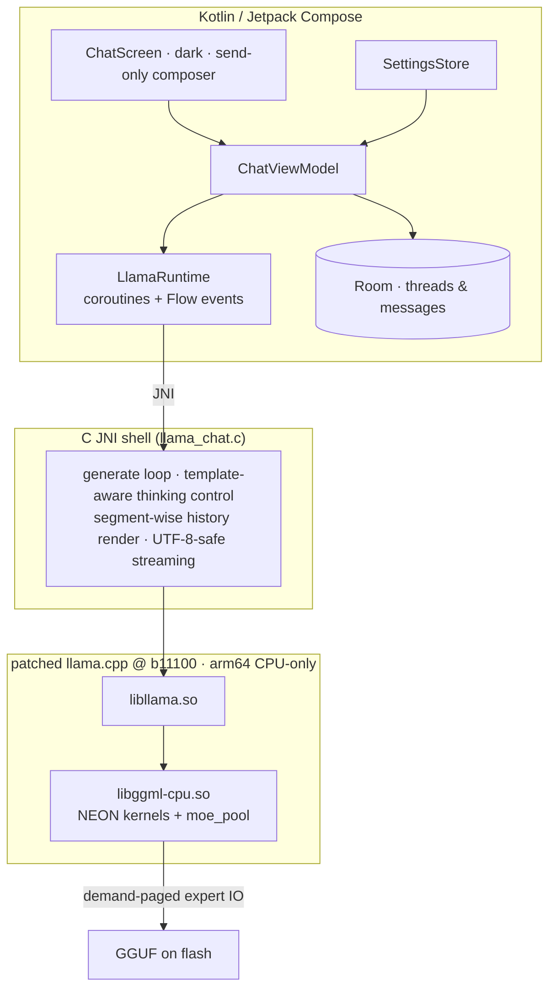

# edge0-android — Release Build Guide

English | [中文](README_zh.md) | [日本語](README_ja.md) | [Español](README_es.md) | [Français](README_fr.md)

This document is for **developers building or evaluating the Android app from source**. It covers: quick start (engine → app → models → test), measured performance on the reference device, and the technical choices behind the stack.

edge0 is published as a **monorepo** — [`Edge0-AI/edge0`](https://github.com/Edge0-AI/edge0) — whose top level holds the shared engine supply (`vendor.llama.pin` + the scripts-materialized `vendor/llama.cpp`, `patches/llama.cpp/` band-sets) and the platform subprojects (`windows/` = the desktop companion, `android/` = this app). Inference runs on pinned upstream llama.cpp, patched as a replayable patch set, fully on-CPU with ARM-NEON kernels and a demand-paged expert pool.

Third-party attribution: see `NOTICE` in this directory. Model cards: [Edge0/Edge0-8B-A1B-preview](https://huggingface.co/Edge0/Edge0-8B-A1B-preview) · [Edge0/Edge0-35B-A3B-preview](https://huggingface.co/Edge0/Edge0-35B-A3B-preview).

---

## 1. Quick Start

### 1.1 Prerequisites

| component | requirement |
|---|---|
| Device | arm64-v8a, Android 13+ (API 33); Snapdragon 8 Elite class recommended |
| RAM | 8 GB+ runs 8B; 12–16 GB runs 35B (expert paging, see §3.2) |
| Toolchain | JDK 17+, Android SDK 35, **NDK r28** (`28.2.13676358`), CMake ≥ 3.21 + Ninja |
| Python | 3.10+ with `numpy` (model converter, runs from the sibling `windows/tools`) |
| Disk | ≥ 30 GB free for model sources and converted GGUF builds |

The NDK is **not** part of this repository — install it once (Android Studio:
*Android SDK → SDK Tools → NDK (Side by side)*, or via CLI):

```bash
sdkmanager --install "ndk;28.2.13676358"
```

Then point the build at it with `NDK_DIR` (or an exported `ANDROID_NDK_HOME`):
`build_vendor_libs.sh` reads the compiler toolchain **and** the `libomp.so`
runtime it stages (§1.2) from inside that NDK installation; a missing NDK
fails fast with that hint rather than producing a broken library set.

### 1.2 Build the engine

The native libraries come from the pinned upstream tree with this platform's
patch bands replayed into an isolated worktree — the vendor tree is **never
patched in place**:

```bash
git clone https://github.com/Edge0-AI/edge0
cd edge0/android
bash tools/llama/build_vendor_libs.sh
```

The script replays `../patches/llama.cpp/{common,android}` (6 + 14 bands) onto
the pinned llama.cpp tree — the pin lives in `../vendor.llama.pin` (currently
`7ab4ee7`, tag b11100); the tree is **not** a submodule, so on first run it is
cloned from upstream into `../vendor/llama.cpp` (gitignored; set
`EDGE0_LLAMA_URL` to use a mirror) and detached at the pin. Replays happen in a
gitignored consumer worktree, the script
asserts the golden result-tree hash, and produces the four engine shared
libraries (plus the NDK `libomp.so` runtime that `libggml-cpu` needs) with
headers into `build-dl/llama-libs/` (the app's jniLibs staging point).
`--replay` re-applies the bands after patch changes; mismatched tree ⇒ RED, the
build refuses to start. This step is required once before the app build —
the Gradle plugin reads these libraries from `build-dl/llama-libs/`.

### 1.3 Build & install the app

```bash
./gradlew :app:assembleDebug
./gradlew :app:installDebug        # or adb install -r app/build/outputs/apk/debug/app-debug.apk
```

### 1.4 Models

GGUF builds are produced locally from the published checkpoints — everything
stays under this directory's `models/` (gitignored):

```bash
huggingface-cli download Edge0/Edge0-8B-A1B-preview --local-dir models/edge0-8b
python ../windows/tools/convert_mlx_to_gguf.py --dir models/edge0-8b
#  → models/edge0-8b-gguf/{edge0-8b.gguf, lora_edge0_8b-gguf.gguf, manifest.json}

huggingface-cli download Edge0/Edge0-35B-A3B-preview --local-dir models/edge0-35b
python ../windows/tools/convert_mlx_to_gguf.py --dir models/edge0-35b

bash tools/model/push_models.sh --all    # md5-gated staging onto the device
```

The converter needs only python3 + numpy (no MLX/torch runtime — "MLX" denotes
the on-disk checkpoint layout). It runs the r3 repack with numeric parity gates
and emits a sha256 manifest; a correct conversion reproduces the baseline
checksums listed in `push_models.sh` byte-for-byte. Models can also be copied
into `files/models/` with the in-app picker.

### 1.5 Run

Launch **Edge0 Chat**. The title bar shows the active model (8B / 35B), the
top-right button switches. The composer is send-only; temperature, thinking and
the system prompt live in the drawer settings. Each reply carries an inline
metrics line: `tokens · TTFT · prefill t/s · decode t/s · RSS`.

### 1.6 Test it

Instrumented regression (needs both models staged — reinstalling the test APK
wipes app data, so restage right before the run):

```bash
./gradlew :app:installDebugAndroidTest
bash tools/model/push_models.sh --all
adb shell am instrument -w -e class dev.edge0.runtime.app.LlamaRuntimeTest \
  dev.edge0.runtime.app.test/androidx.test.runner.AndroidJUnitRunner
# expected: OK (8 tests), ~7 min on the reference device
```

Coverage: 8B/35B smoke, 35B↔8B in-process switching, prefix-reuse fidelity,
thinking on/off × system-prompt quadrants (8B gate + 35B off leak probe), and
identity retention across multi-turn rendering. Host-side logic tests:
`./gradlew :app:testDebugUnitTest` (no device needed).

### 1.7 Benchmark (community submission block)

`BenchTest` measures decode speed, prefill speed and peak memory of a model on a real phone and
prints the result block used by the
[Hardware Benchmarks](https://github.com/Edge0-AI/Edge0/discussions/142) Discussion
(`runtime: android`). Besides the speed and memory numbers, the block records the device model, SoC,
RAM and Android version and the engine commit, so it is ready to paste.

#### What you need

- A phone connected over USB with USB debugging on (`adb devices` lists it as `device`).
- The app and the test APK installed (§1.3) and the model staged on the phone (§1.4).
- A tier that fits the phone: `8b` runs on any 8 GB+ phone, `35b` needs 12 GB+.

#### Quick start

```bash
./gradlew :app:installDebug :app:installDebugAndroidTest
bash tools/model/push_models.sh --8b          # or --35b; restage if the app's data was cleared
bash tools/bench/run_bench.sh --8b --reporter @your-handle
```

The last command prints the block on stdout and nothing else, so it can be redirected:
`bash tools/bench/run_bench.sh --8b > block.txt`.

#### The runner script: `tools/bench/run_bench.sh`

```
bash tools/bench/run_bench.sh --8b | --35b [--reporter @handle] [--notes "text"] [--temperature 0.2]
```

| Option | Required | Meaning |
|---|---|---|
| `--8b` / `--35b` | yes | The tier to run. If both are given, the last one wins. |
| `--reporter @handle` | no | Your handle, written to the `reporter` field. The `@` is added if missing. |
| `--notes "text"` | no | Free text appended to the `notes` field (for example `case on, charging`). Quotes and spaces are safe. |
| `--temperature 0.2` | no | Sampling temperature, 0 (greedy) to 2. The default, 0.2, is the app's own default. See "Sampling". |

| Environment | Meaning |
|---|---|
| `ADB_SERIAL` | Which device to use. Required when more than one is attached (`adb devices` shows the serials). |

What it does, in order:

1. Checks that `adb` sees a usable device. If not, it stops with exit code 1 and tells you to check
   `adb devices` or set `ADB_SERIAL`.
2. Starts the instrumented test with `adb shell am instrument -w`, passing the tier, reporter and
   notes. It prints one line to stderr, then stays silent until the run ends (see "Following
   progress").
3. Reads the block out of the instrumentation output and prints it to stdout.
4. If no block was produced, or the test failed, it prints the full instrumentation output to
   stderr and exits with code 1. The failure text from the test is in that output.

Exit codes: `0` block printed, `1` no device or no block (including a failed test), `2` bad
arguments.

The script does not check beforehand that the APKs and the model are on the phone. The test
reports it: a missing model fails with `edge0-<tier>.gguf not found under files/models`, and a
missing test APK fails with `INSTRUMENTATION_FAILED` and "Unable to find instrumentation info".

Without the script, the same run is:

```bash
adb shell am instrument -w -e class dev.edge0.runtime.app.BenchTest \
  -e tier 8b -e reporter @your-handle \
  dev.edge0.runtime.app.test/androidx.test.runner.AndroidJUnitRunner
```

Besides the instrumentation output, the test logs the block under the tag `E0Bench` and saves a
copy to `/sdcard/Android/data/dev.edge0.runtime.app/files/bench-edge0-<tier>.txt` (`adb pull`).
`BenchTest` does nothing unless `-e tier` is given, so other instrumented runs are unaffected.

#### Running through Gradle

The same test can be run as a Gradle connected test. Install the app and stage the model first, then
name the test class and pass the arguments as Gradle properties:

```bash
./gradlew :app:installDebug                 # the app must exist before the model can be staged (§1.4)
./gradlew :app:connectedDebugAndroidTest \
  -Pandroid.testInstrumentationRunnerArguments.class=dev.edge0.runtime.app.BenchTest \
  -Pandroid.testInstrumentationRunnerArguments.tier=8b \
  -Pandroid.testInstrumentationRunnerArguments.reporter=@your-handle
```

- Always pass `class=`: without it Gradle runs every instrumented test, including
  `LlamaRuntimeTest`, which needs both models. Without `tier=`, `BenchTest` skips itself.
- Gradle reinstalls the app in place, so the model you staged is still there for the run. When the run
  ends it **uninstalls both APKs, which removes the staged model**, so stage it again for the next run.
- The console only shows pass or fail. The block is recorded in
  `app/build/outputs/androidTest-results/connected/debug/<device>/` (`test-result.textproto`, key
  `submission_block`) and in the logcat attachment next to it, which prints it with:

  ```bash
  sed -n 's/.*E0Bench *: //p' app/build/outputs/androidTest-results/connected/debug/*/logcat-*BenchTest*.txt
  ```

- Gradle warns that runner arguments given on the command line are not compatible with its
  configuration cache. The arguments still reach the test; the run just does not use the cache.

#### What the benchmark does

- **Prompt:** one fixed prompt of about 3.3k tokens, built from the `BENCH_LONG=1` paragraphs of
  `python/examples/bench.py` plus an instruction that asks for a long answer. Thinking is off.
- **Protocol:** one cold warmup run, then 2 measured runs with a 5 s pause between them. Each run
  starts from scratch, so every run pays a full prefill. The block reports the mean of the 2
  measured runs. The warmup is not averaged, but its numbers and each measured run's are listed in
  `notes`.
- **Decode:** exactly 200 new tokens, so every run measures an extended decode, sampled at
  temperature 0.2 by default (the app's own default; `--temperature 0` is greedy). See "Sampling".
  The engine cannot be told to ignore end-of-sequence, so a run where the model stops earlier fails
  instead of reporting a shorter window.
- **Timing:** prefill and decode speeds come from the engine's own timers, as in the app's
  metrics line.
- **Peak memory:** the process's peak resident set (`VmHWM`). The benchmark resets that counter
  before every run (by writing `5` to `/proc/self/clear_refs`), so each run reports its own peak, and
  the block shows the highest of the measured runs. If the phone refuses the reset, the number is the
  whole-process maximum and `notes` says so. It includes memory-mapped model pages that are resident
  at the time, so it is not the model's size and not comparable to MLX's allocator peak.
- **Comparable runs only:** a run fails instead of reporting if the prompt is outside 2.8k-3.8k
  tokens, the prefix cache was reused, or decode did not produce exactly 200 tokens.

Differences from `python/examples/bench.py`: the Android run reports a mean of 2 runs after a cold
warmup (the Python bench reports its cold and warm runs) and has no 10-token untimed decode warmup
inside a run; the model may end its answer early, which fails the run (the Python bench always
decodes 200 tokens); only the temperature is applied when sampling (next section); and peak memory
is the process's resident peak, not MLX's allocator peak.

#### Sampling

| Setting | `python/examples/bench.py` | Android benchmark |
|---|---|---|
| Temperature | `BENCH_TEMP`, default 0.7 | `--temperature`, default 0.2 (the app's default); 0 is greedy |
| Top-k | model config, default 64 | Not applied. With temperature above 0 the engine always uses top-k 40. |
| Top-p | model config, default 0.95 | Not applied. The engine has no top-p. |
| Repetition penalty | model config, default off | Not applied. |
| Seed | `BENCH_SEED`, optional | Fixed inside the engine. |

The app's Settings screen has top-k and top-p sliders, but the llama path forwards only the
temperature to the engine (`LlamaRuntime.kt`), so they have no effect there either. Applying them
needs a change to the engine's decode loop (`llama_chat.c`), which the benchmark does not touch.

#### The block

```
tier:            edge0-8b
runtime:         android
device:          Samsung SM-S911U
soc:             Snapdragon 8 Gen 2
ram_gb:          8
os:              Android 16 (API 36)
decode_tok_s:    1.14
prefill_tok_s:   10.3
peak_active_gib: 3.40
engine_commit:   7ab4ee7baad2d920464cbacfad4f4b07cf111fd2
reporter:        @your-handle
notes:           cold run: decode 1.80 tok/s, prefill 10.4 tok/s, peak 3.54 GiB; run 1: decode 1.56 tok/s, prefill 10.0 tok/s, peak 3.33 GiB; run 2: decode 0.72 tok/s, prefill 10.7 tok/s, peak 3.40 GiB; 3301-token prompt, 200 decoded, mean of 2 reps, temperature 0.2
```

The block above is the output of one run of the 8B tier on an 8 GB phone, where the 5 GB model does
not fit in free memory (see below). The screen turned off during run 2, which decoded at less than
half the speed of run 1; the notes list every run so that an outlier like this stays visible.

| Field | Who fills it |
|---|---|
| `tier`, `runtime` | The benchmark. |
| `decode_tok_s`, `prefill_tok_s`, `peak_active_gib` | The benchmark (means of the 2 measured runs; peak is the highest of the two). |
| `engine_commit` | The benchmark: the pinned engine commit from `vendor.llama.pin`. |
| `reporter` | `--reporter`. |
| `notes` | The benchmark adds the cold run and each measured run (decode, prefill and, when the peak could be reset per run, peak), the prompt length, tokens decoded, run count and temperature; `--notes` is appended. |
| `device`, `soc`, `ram_gb`, `os` | The benchmark, from the Android framework. `device` is manufacturer and model. `soc` is the chip: known Qualcomm codes are mapped to marketing names (`SM8550` becomes Snapdragon 8 Gen 2), any other chip is shown as vendor and model code. `ram_gb` is total memory rounded up to the marketed size (a phone that reports 7.4 GiB shows 8). `os` is the Android release and API level. |

#### Following progress

The runner prints nothing until the run finishes. To follow progress, watch the engine log in a
second terminal:

```bash
adb logcat -s E0LLAMA
```

The benchmark sends three requests: the warmup, then runs 1 and 2. Each logs a `REND` line when it
starts, `PRE fill ...` when its prefill is done, and `OK gen=... tps=... prefill_ms=...` when it
finishes, so the third `OK gen=` line means the run is nearly over.

#### Getting representative numbers

The model file is memory-mapped. When it is larger than the free memory on the phone, the weights
are read back from flash again and again, and speed drops sharply (an 8 GB phone running the 5 GB
8B model reaches only a few tokens per second, and the warmup alone can take several minutes). For a
representative number, reboot, close other apps, keep the screen on for the whole run, and note in
`--notes` whether the phone was charging and how much memory was free. The notes list every run, so a
run that was disturbed (for example the screen turning off partway) shows up as an outlier instead of
being hidden in the mean.

#### Troubleshooting

| Message | Meaning and fix |
|---|---|
| `no usable device` | `adb devices` shows nothing usable. Unlock the phone, accept the USB debugging prompt, or set `ADB_SERIAL`. |
| `INSTRUMENTATION_FAILED` / `Unable to find instrumentation info` | The test APK is not installed. Run `./gradlew :app:installDebugAndroidTest`. |
| `edge0-<tier>.gguf not found under files/models` | The model is not staged, or the app's data was cleared. Stage it again (§1.4). |
| `load failed: ...` | The engine could not load the model. The text after it is the engine's reason. |
| `prefix cache reused N tokens` | The run did not pay a full prefill, so the prefill speed would be wrong. Re-run. |
| `prompt is N tokens, expected 2800..3800` | The tokenizer produced a different prompt length than the benchmark was designed for. Report it. |
| `decode stopped after N tokens, need exactly 200` | The model ended its answer early, or the engine hit a decode error (for example a full KV cache). The engine reports such an error as a normal, shorter answer, so the two look the same. Re-run; if it repeats, report it with the tier and the number of tokens. |

#### Code layout

| File | Role |
|---|---|
| `app/src/main/java/dev/edge0/runtime/app/bench/Bench.kt` | Tiers, instrumentation arguments, the fixed prompt, the measurement protocol and its results. |
| `app/src/main/java/dev/edge0/runtime/app/bench/BenchBlock.kt` | Renders the submission block and the per-run notes; holds the device-name, SoC and RAM helpers. |
| `app/src/main/java/dev/edge0/runtime/app/bench/DeviceProbe.kt` | Reads the device model, SoC, RAM and Android version from the Android framework, and resets the peak-memory counter. |
| `app/src/androidTest/java/dev/edge0/runtime/app/BenchTest.kt` | The instrumented test: reads the arguments, loads the model, runs the protocol, prints the block. |
| `app/src/test/java/dev/edge0/runtime/app/bench/` | JVM unit tests for the protocol and the block (no device needed). |
| `tools/bench/run_bench.sh` | The runner script described above. |

The protocol only depends on the app's `Runtime` interface, so it is unit-tested with a scripted
runtime. `app/build.gradle.kts` adds a `BuildConfig.ENGINE_COMMIT` field read from
`../vendor.llama.pin`.

---

## 2. Performance

Reference device: **Lenovo TB322FC (Snapdragon 8 Elite, 16 GB RAM)**, shipping
config, sustained windows (first segments = boost clocks, tail = thermal steady
state — both reported rather than cherry-picked peaks).

| Model | TTFT (warm turn) | Decode | Prefill | Session RSS |
|---|---:|---:|---:|---:|
| **8B** (Q8-class GGUF + LoRA) | ≈ 1.4 s | 29–32 → ~10 t/s over a 480 s window | ~100 t/s | ≈ 250 MB |
| **35B** (mixed int8 MoE, demand-paged) | ≈ 1.1 s warm (≈ 10–15 s on the very first turn of a new topic — cold expert pool, flash-bound) | 6–9 t/s in-app (9.46 t/s sustained CLI) | ~1 s per incremental turn | pool budget 2–6 GB; resident ≪ file size |

Notes: "first turn of a new topic" pays the cold-pool tax — e.g. a 55-token
question measured prefill 12.8 s with 25956 expert loads, 73 % of wall time in
flash I/O wait; that is demand paging working as designed, not a regression.
Turn two onwards is warm: KV prefix reuse + keepwarm refill bring TTFT to ~1 s.
Decode decay along a long window is DVFS/thermal behavior on this SoC.

---

## 3. Technical Details

### 3.1 Architecture



### 3.2 Why a 21.7 GB MoE fits on a phone — `moe_pool`

The 35B model activates only a moving subset of its 256-per-layer experts per
token, so the shipped design pages experts **on demand** from flash instead of
resident memory (`ggml/src/ggml-cpu/moe_pool.c`, developed as the 14-patch
android band): copy-in private frames, an equal-slot state machine, background
IO staging queues tuned to measured UFS throughput, pin/blob/trim controls, a
turn-end keepwarm refill within a byte budget, and full cross-model reset
enabling 8B↔35B switching inside one process. With the pool disabled the engine
resolves expert rows exactly like upstream (NULL resolver ⇒ zero perturbation,
verified by symbol-set diffing). This is the same mechanism family the desktop
project implements over NVMe + Vulkan; here it is CPU/NEON by design — GPU
backends stay out of the shipping config for deterministic numerics and a
single memory model.

### 3.3 Repo map

```
app/                     Android app: Compose UI (src/main/java), JNI shell (src/main/cpp),
                         instrumented + unit tests (src/androidTest, src/test)
tools/llama/             build_vendor_libs.sh — engine rebuild from the pinned tree + bands
tools/model/             push_models.sh — md5-gated model staging to devices
tools/bench/             run_bench.sh — on-device benchmark runner (§1.7)
../vendor/llama.cpp/     materialized by the build scripts from vendor.llama.pin (gitignored; never patched in place)
../patches/llama.cpp/    common(6) + android(14) hook-point bands + ledger README
../windows/              desktop companion — hosts the MLX→GGUF converter used in §1.4
```
